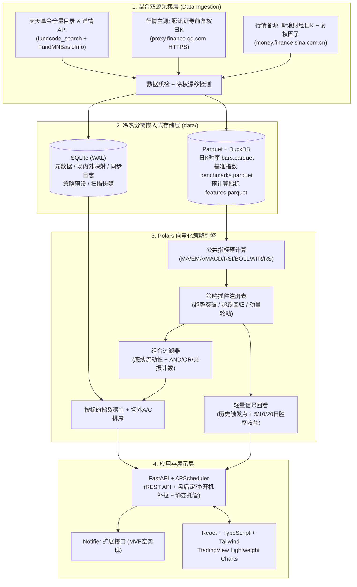

# ChanceDetect v1 — Technical Specification

> **定位**：面向场外基金投资者的盘后日频量化选基工具。基于高流动性场内基金（ETF / LOF）的量价与技术面信号寻找机会，严格限定标的池为「存在对应场外基金（ETF 联接基金 / 可场外申赎 LOF）」的品种，并按跟踪标的指数聚合呈现对应场外 A/C 份额清单，辅助次日场外申购决策。

---

## 1. 核心目标与约束

1. **交易节律**：纯盘后日频复盘（不依赖盘中实时行情），支持每日收盘后自动同步，以及本地 Mac 休眠/关机错过调度后的开机自动补拉。
2. **标的池口径（严格一对多映射）**：
   - 仅保留满足以下条件之一的场内基金：
     1. 场内 **ETF**（代码前缀 `51/52/56/58/15`）且存在明确对应的场外 **ETF 联接基金**；
     2. 场内 **LOF**（代码前缀 `16/50`）且本身支持场外申赎（非纯场内交易），并关联其同基金其他场外份额（如 C 类）。
   - 每只符合条件的场内基金一对多关联其全部对应场外 A/C 份额。
3. **数据维度**：量价与技术面指标（日 K 复权 OHLCV、成交额、换手率、均线/EMA/MACD/RSI/布林带/动量/回撤/波动率，以及基准指数日 K 用于相对强弱计算）。
4. **核心工程指标**：
   - **数据源稳定可靠**：免费混合双源架构，主备自动降级、除权分红漂移检测与全量修正、入库前数据质检、同步健康日志可观测。
   - **过滤速度**：全市场（~600–1,200 只基金 × 多年日 K，百万级数据行）多策略向量化扫描控制在 **< 200ms**。
   - **存储机制**：嵌入式冷热分离（SQLite + DuckDB/Parquet），零独立数据库运维，本地 `data/` 目录即完整状态。
   - **交付形态**：本地 Web 看板（含 K 线与历史信号打点、N 日前瞻收益统计、策略调参与多策略组合）+ Docker 一键部署；MVP 仅预留 `Notifier` 通知接口，不做消息推送。

---

## 2. 系统总体架构



---

## 3. 数据源与可靠性设计

### 3.1 元数据与场内↔场外严格映射算法
1. **全量基金目录拉取**：通过 `https://fund.eastmoney.com/js/fundcode_search.js` 一次性获取全市场基金清单（~28,000+ 条），按命名和代码前缀筛选三类候选集：
   - 场内 ETF 候选：`code` 以 `51/52/56/58/15` 开头，名称含 `ETF` 且不含 `联接`；
   - 场外 ETF 联接候选：名称含 `联接`（剔除后端收费/非 RMB 现汇等异常份额或显式标注）；
   - 场内 LOF 候选：`code` 以 `16/50` 开头，名称含 `LOF`（剔除后端份额）。
2. **详情补全（低频缓存 + 并发限流）**：调用 `https://fundmobapi.eastmoney.com/FundMNewApi/FundMNBasicInformation` 获取 `JJGSID`（基金公司 ID）、`INDEXCODE`/`INDEXNAME`（跟踪标的指数）、`LISTTEXCH`（上市交易所 `1=sh, 2=sz`）、`SGZT`/`SHZT`（申赎状态）、`ESTABDATE`（成立日期）、`ENDNAV`（基金规模）、`RATE`（申购费率）。
3. **严格映射匹配规则**：
   - **ETF ↔ ETF 联接**：
     1. 主匹配键：`(jjgs_id, index_code)` 精确一致；
     2. 歧义消解：同一基金公司同一指数下若存在多只 ETF（如普通 ETF 与增强 ETF），按名称特征词（`增强`/`联接` 去掉后缀后的相似度）以及 `fund.eastmoney.com/{code}.html` 的「查看相关ETF>」显式链接精准消解；
     3. 自动解析场外份额类型：`A` / `C` / `E` / `I` / `OTHER`。
   - **LOF 场内外映射**：
     1. 具备 `LISTTEXCH`（已上市）且 `SGZT != '场内交易'` 的 LOF，自身即构成一条 `LOF_SELF` 映射；
     2. 在全量目录中按相同基金公司 + 去除 `A/C/E` 后缀后的基础名称，关联其场外兄弟份额（如 `161725` 招商中证白酒(LOF)A 关联 `012414` 招商中证白酒(LOF)C）。
4. **容错保护**：映射表仅在每周定时或手动刷新时更新；刷新前后做行数骤降保护（如新结果少于旧结果 70% 则中止替换并告警），确保不会因接口临时异常清空映射表。

### 3.2 日 K 行情双源采集与一致性保障
- **主源（TencentProvider）**：`https://proxy.finance.qq.com/ifzqgtimg/appstock/app/newfqkline/get`
  - 直接返回前复权日 K（`qfqday`），含 `date, open, close, high, low, volume, turnover_pct, amount`；
  - 单次上限 640 交易日，历史冷启动按时间窗口自动分页拼接（默认拉取近 5 年，可配置为全量）；
  - 同步拉取核心基准指数（默认沪深 300 `sh000300`、中证 500 `sh000905`、创业板指 `sz399006`）。
- **备源（SinaProvider）**：`https://money.finance.sina.com.cn/quotes_service/api/json_v2.php/CN_MarketData.getKLineData` + `qfq.js` 前复权因子计算。
  - 当主源超时、返回空数据或连续失败时自动切换备源，并在 `sync_runs` 记录数据源来源（`source='tencent'|'sina'`）。
- **除权/分红漂移检测（关键可靠性设计）**：
  - 每次增量更新时，向前多拉取最近 **5 个交易日** 的重叠窗口，与本地已存储的最近 5 日 `close` 对比；
  - 若重叠区间价格相对误差 > `0.2%`（说明该基金发生分红/拆分导致前复权基准变化），自动触发该基金 **历史全量重拉并覆盖**，彻底杜绝技术指标断层。
- **入库前质检（DataQualityValidator）**：
  - 必须满足：`high >= max(open, close) >= min(open, close) >= low > 0`、`volume >= 0`；
  - 按 `(symbol, trade_date)` 去重并严格升序；
  - 检测单日异常涨跌幅（> 25% 且非新上市首日）写入 `sync_errors` 供人工核查但不静默丢弃。

---

## 4. 存储层 Schema 设计

所有持久化文件统一位于 `data/` 目录（可通过环境变量 `CHANCE_DATA_DIR` 配置）：

```text
data/
├── metadata.sqlite          # SQLite (WAL 模式)
├── bars/
│   ├── daily_bars.parquet   # 全部场内基金日K时序
│   └── benchmarks.parquet   # 基准指数日K时序
└── cache/
    └── features.parquet     # 预计算公共技术指标宽表
```

### 4.1 SQLite 表结构
1. `exchange_funds`
   - `symbol` (PK, e.g. `sh510300`), `code` (`510300`), `exchange` (`sh`/`sz`), `name`, `fund_type` (`ETF`/`LOF`), `index_code`, `index_name`, `company_id`, `company_name`, `establish_date`, `fund_scale` (float, 亿元), `latest_trade_date`, `avg_amount_20d` (float, 万元), `is_active` (bool), `updated_at`
2. `otc_fund_mappings`
   - `id` (PK), `exchange_symbol` (FK -> `exchange_funds.symbol`, indexed), `otc_code`, `otc_name`, `share_class` (`A`/`C`/`E`/`OTHER`), `mapping_type` (`FEEDER`/`LOF_SELF`/`LOF_SIBLING`), `purchase_status` (`开放申购`/`限大额`/`暂停申购`等), `fee_rate`, `updated_at`
   - Unique index on `(exchange_symbol, otc_code)`
3. `sync_runs`
   - `id` (PK), `job_type` (`metadata`/`daily_bars`/`full_sync`), `status` (`running`/`success`/`partial`/`failed`), `started_at`, `finished_at`, `total_targets`, `succeeded_count`, `failed_count`, `primary_source_count`, `fallback_source_count`, `drift_refreshed_count`, `summary_json`
4. `sync_errors`
   - `id` (PK), `run_id` (FK), `symbol`, `stage`, `provider`, `error_message`, `created_at`
5. `strategy_presets`
   - `id` (PK), `name`, `description`, `config_json` (组合逻辑、启用的策略与参数、底线过滤、场外份额偏好), `created_at`, `updated_at`
6. `scan_snapshots`
   - `id` (PK), `trade_date`, `preset_id` (nullable), `config_json`, `hit_fund_count`, `hit_index_count`, `elapsed_ms`, `result_json`, `created_at`

### 4.2 Parquet / DuckDB 时序 Schema
- `daily_bars.parquet`（按 `symbol, trade_date` 排序，ZSTD 压缩）：
  - `symbol: Utf8`, `trade_date: Date`, `open: Float64`, `high: Float64`, `low: Float64`, `close: Float64`, `volume: Float64`, `amount: Float64`（万元）, `turnover_pct: Float64`, `pct_chg: Float64`, `source: Utf8`
- `benchmarks.parquet`：
  - `benchmark_code: Utf8` (`sh000300` 等), `trade_date: Date`, `open/high/low/close/volume/amount/pct_chg: Float64`
- `features.parquet`：
  - 在 `daily_bars` 基础上附加常用预计算列（`ma5, ma10, ma20, ma60, ema12, ema26, macd_dif, macd_dea, macd_hist, rsi14, boll_mid, boll_upper, boll_lower, bias20, vol_ma5, vol_ma20, avg_amount_20d, ret_5d, ret_20d, ret_60d, volatility_20d, rs_20d` 等），由每次数据同步完成后自动重算刷新，确保查询期极速响应。

---

## 5. 策略引擎与内置策略集合

### 5.1 统一面板策略接口（Python 插件机制）
```python
class BaseStrategy(ABC):
    id: str                          # 唯一标识，如 "ma_bullish_breakout"
    name: str                        # 中文名
    category: Literal["trend", "mean_reversion", "momentum"]
    description: str                 # 策略逻辑说明
    params_model: type[BaseModel]    # Pydantic 参数 Schema（自动生成前端表单）

    @abstractmethod
    def evaluate(
        self,
        panel: pl.DataFrame,         # 含全市场所有符合底线过滤的基金日K与基础列
        benchmarks: pl.DataFrame,    # 基准指数日K
        params: BaseModel,
    ) -> pl.DataFrame:
        """
        返回包含 [symbol, trade_date, signal(bool), score(float), reason(str)] 的 DataFrame。
        """
```

- **性能设计**：全部策略基于 Polars 表达式（`.over("symbol")` 分组窗口运算 + `.over("trade_date")` 横截面排名运算）编写，无 Python 行级循环。
- **底线过滤器（BaseUniverseFilter）**：执行策略前先按用户配置过滤低质标的（默认：`avg_amount_20d >= 1000` 万元、`listing_days >= 60` 交易日，可在前端自由调整或关闭）。
- **多策略组合模式**：
  - `AND`：同时命中所有已启用策略；
  - `OR`：命中任一已启用策略；
  - `RESONANCE`（共振计数）：至少命中 `min_hits` 个已启用策略，并按命中策略数与归一化综合得分降序排列。
- **按标的指数智能聚合**：
  - 同一 `index_code`（若无 `index_code` 则按单只基金自身分组）下命中策略的多只场内基金合并为 1 个机会组；
  - 组内选取 `avg_amount_20d` 最高的场内基金作为主代表展示 K 线、技术指标与信号理由；
  - 聚合该组内所有场内基金关联的全部场外基金（去重后按 `share_class` 偏好排序：默认 `C` 类优先或 `A` 类优先可一键切换）。
- **轻量历史信号回看（Signal Replay）**：
  - 对用户选中的任意场内基金 + 当前策略组合，直接复用 `evaluate()` 的全历史 `signal` 序列，提取近 N 年（默认 2 年）历史触发日期列表；
  - 向量化计算每次信号触发后 **T+1 / T+5 / T+10 / T+20** 的收益率、胜率（收益 > 0 占比）、平均收益、中位收益与最大回撤（注：同时提示场外基金按收盘净值确认的 T+1 持仓节奏）。

### 5.2 MVP 首批内置策略（共 7 个，覆盖三大类）
1. **趋势突破类 (`trend`)**
   - `ma_bullish_alignment`（均线多头启动）：`MA_fast > MA_mid > MA_slow` 且当日向上拐头、收盘站上短期均线，放量加分。
   - `volume_high_breakout`（放量突破 N 日新高）：收盘突破近 N 日（默认 20）最高收盘价，且成交量 ≥ M 日均量的 K 倍（默认 1.5x）。
   - `macd_golden_cross`（MACD 零轴附近金叉）：DIF 上穿 DEA（当日金叉），支持参数控制是否要求零轴上方及柱体放大。
2. **超跌均值回归类 (`mean_reversion`)**
   - `rsi_oversold_rebound`（RSI 低位超卖企稳）：RSI(N) 跌破超卖阈值（默认 30）后当日拐头回升或收盘翻红。
   - `boll_lower_reversal`（布林带下轨反抽）：前 1–2 日触及/跌破布林下轨，当日收阳站回下轨上方。
   - `ma_negative_bias`（均线负乖离率极值）：`(close - MA_N) / MA_N <= -threshold%`（默认 -6%）且跌势收窄，捕捉超跌偏离机会。
3. **动量轮动类 (`momentum`)**
   - `momentum_top_rank`（横截面动量轮动 Top K）：计算近 N 日（默认 20）风险调整动量（收益率 / 波动率，或纯动量），在全市场横截面排名前 K（默认前 15）且处于长期均线（如 MA60）上方过滤下行趋势。
   - `relative_strength_rs`（相对大盘超额强弱 RS 走强）：基金相对沪深 300 基准的比值曲线 `RS = close / bench_close` 站上自身 M 日均线且近 N 日超额收益为正并创近期 RS 新高。

*(共计 8 个完整内置策略，覆盖趋势、超跌、动量三大方向)*

---

## 6. REST API、调度与通知预留

### 6.1 核心 API 端点（Prefix: `/api/v1`）
- `GET /health` — 服务状态、数据最新交易日、基金池规模
- `GET /strategies` — 返回所有已注册策略元信息及 JSON Schema（用于前端动态表单）
- `POST /scan` — 执行实时策略组合扫描（传入策略列表、参数、组合模式、底线过滤、份额偏好、目标日期），返回按指数聚合的机会列表 + 耗时 `elapsed_ms`
- `GET /scan/snapshots` — 历史扫描快照列表与详情
- `GET /presets` / `POST /presets` / `DELETE /presets/{id}` — 策略组合预设管理
- `GET /funds/{symbol}/replay` — 获取个基日 K 数据、均线/指标序列、在当前策略下的历史触发点、以及 5/10/20 日前瞻胜率统计与关联场外基金详情
- `GET /funds` — 基金池检索（支持按代码、名称、跟踪指数、场外代码搜索）
- `GET /sync/status` — 最新同步状态、数据源健康统计、最近 `sync_runs` 与 `sync_errors`
- `POST /sync/trigger` — 手动触发同步（支持 `mode=daily|metadata|full`，后台异步执行并可轮询进度）

### 6.2 调度与自动补拉（APScheduler）
- 默认配置：每个工作日 `16:15`（A 股收盘且行情源日 K 稳定归档后）自动执行盘后增量同步；每周日 `10:00` 自动刷新场内↔场外映射元数据。
- **Mac 休眠补拉机制**：服务启动时 + 每 30 分钟检查一次本地 `latest_trade_date` 与当前时间（若已过交易日 16:15 且当日未成功同步），自动在后台补拉缺失交易日数据。
- **通知预留**：定义 `Notifier` 抽象基类与 `NoopNotifier` 默认实现，盘后定时扫描完成钩子预留调用位，后续接入飞书/企微/微信推送零侵入。

---

## 7. Web 看板设计（React + TypeScript + Tailwind）

采用深色专业金融终端美学（紧凑清晰、高信息密度、红涨绿跌符合 A 股习惯），三大核心视图：

1. **机会筛选工作台（Scanner — 首页）**
   - 左侧/顶部可折叠策略面板：按「趋势突破 / 超跌回归 / 动量轮动」分组勾选策略，展开可实时调节 Pydantic 驱动的参数；选择组合逻辑（AND / OR / 共振 ≥ K）、底线流动性过滤、默认场外份额偏好（C 类优先 / A 类优先）、以及一键保存/加载预设。
   - 右侧主结果区：显示本次过滤耗时（如 `42ms`）、命中标的指数数与场内基金数；列表**按跟踪指数聚合卡片/表格**呈现（主代表 ETF 名称/代码、涨跌幅、20 日均额、命中策略标签、综合评分），展开即可一键复制对应**场外基金代码（C/A 分类标签 + 申购状态）**。
2. **个基深度复盘抽屉/页面（Fund Detail & Signal Replay）**
   - 集成 **TradingView Lightweight Charts**：日 K 蜡烛图 + 成交量柱状图 + MA5/20/60 均线开关 + **历史策略触发点 Markers**；
   - 右侧/上方卡片：轻量历史信号回看统计（近 2 年触发次数、T+5 / T+10 / T+20 胜率与平均收益率）、以及该指数下全部对应场外基金（A/C 份额代码、名称、映射类型、申购状态、一键复制代码）。
3. **数据源与池子管理（Data & Universe）**
   - 数据健康仪表盘：当前覆盖场内 ETF/LOF 数量、对应场外基金数量、最新行情日期、主备源命中率、除权漂移自动修复次数；
   - 一键触发「盘后增量同步」「刷新场内外映射」「全量重算指标」，实时查看同步进度与异常日志；
   - 基金池搜索表：验证任意场内基金或场外代码是否在池内及映射关系。

---

## 8. 分阶段实施路线

- **阶段一（数据底座）**：搭建 Python (`uv`) 后端工程结构、SQLite + DuckDB/Parquet 存储引擎、天天基金映射构建器、腾讯主源 + 新浪备源日 K 采集器、除权漂移检测与数据质检器、CLI 工具，并完成单元测试 + 真实数据联调验证。
- **阶段二（策略与服务）**：实现 Polars 公共指标预计算层、8 个内置向量化策略插件、组合过滤器、指数聚合器、轻量历史信号回看统计、FastAPI REST API 与 APScheduler 自动补拉调度，编写完备的单元/集成测试与性能基准测试。
- **阶段三（Web 看板与交付）**：搭建 React + Vite + Tailwind + Lightweight Charts 前端，实现全部三大视图并与真实后端联调，配置 FastAPI 单端口静态托管、`Dockerfile` / `docker-compose.yml` 与 `README.md`，完成全链路端到端验证。
